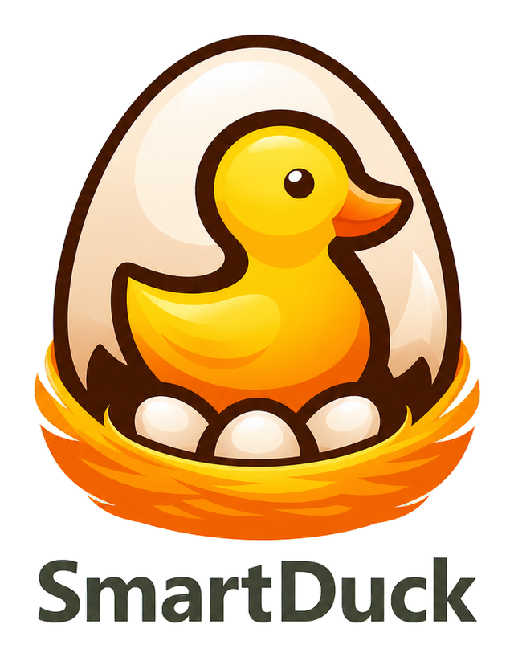

<p align="center">
  
</p>

<p align="center">
  
  
  
  
  
  
  
  
</p>

---

##  About

SmartDuck was made for Uno Duck Farm in Sta. Catalina Sur, Candelaria, Quezon, which
produces balut and penoy. It is an incubator for duck eggs that is watched and controlled
from a website.
A DHT22 sensor inside the incubator reads the temperature and humidity every 2 seconds,
and an ESP32 board keeps the eggs in the right conditions. During a batch it:

- turns on the heater and light when the temperature drops to 37.3 °C, and off at 37.7 °C
- runs the cooling fan when the temperature reaches 37.7 °C, until it is back at 37.3 °C
- turns the eggs once every 4 hours
- lowers the egg tray on Day 7 and Day 14 for candling, with the candling light on,
  and raises it again after 10 minutes
- alerts the staff when the temperature or humidity goes out of range

Administrators and users follow every batch on a web dashboard, from the day the eggs
are set to hatch day. They can also switch each part ON, OFF or AUTO by hand and
download reports.

This repository has the website (frontend) and only a small part of the backend. The PHP
API (`api/`) and the ESP32 firmware are not included.

> [!IMPORTANT]
> **There is no sensitive information in this repository.** No API keys, no passwords,
> no `.env` files, no Firebase service-account key, no email or SMS credentials and no
> database files. The server reads its keys from the computer it runs on, so none of
> them are written in the code.

---

##  Database

<table>
  <tr>
    <td width="50%" align="center" valign="top">
      
      <h3>Firebase</h3>
      <p><b>Online database (Realtime Database)</b></p>
      <p>Stores the accounts, batches, sensor readings, incubator parts, alerts, reports
      and history. Only the server talks to it. The website and the ESP32 never do.</p>
    </td>
    <td width="50%" align="center" valign="top">
      
      <h3>Local JSON file</h3>
      <p><b>Backup on the computer running SmartDuck</b></p>
      <p>Keeps SmartDuck working when Firebase cannot be reached, so the dashboard and
      the incubator keep going during an outage.</p>
    </td>
  </tr>
</table>

The tables and how they connect are in [docs/smartduck-erd.md](docs/smartduck-erd.md).

---

##  Languages used

<p align="center">
  
</p>

| Language | Type | Used for |
| --- | --- | --- |
|  **JavaScript** | Programming language | The dashboard, live graphs, part controls and the PDF and Excel reports |
|  **HTML5** | Markup language | The administrator, user and sign-in pages |
|  **CSS3** | Style sheet language | Layout, colors and the phone layout |
|  **PHP** | Programming language | The server: sign-in, batches, alerts, reports and the ESP32 check-in |

---

##  What SmartDuck monitors

| | Reading | Sensor | What SmartDuck does with it |
| :---: | --- | --- | --- |
|  | **Temperature** | DHT22 | Turns on the heater at 37.3 °C and the fan at 37.7 °C, alerts when it leaves that range |
|  | **Humidity** | DHT22 | Alerts the staff when it goes below 50% or above 70% |
|  | **Part status** | ESP32 | Shows if each part is on, off or not running, and sends an SMS when it changes |
|  | **Batch day** | Server clock | Counts the days of each batch, with candling on Day 7 and Day 14 |

##  What SmartDuck controls

Every part can be set to **ON**, **OFF** or **AUTO** from the dashboard. In AUTO:

| | Part | How it runs |
| :---: | --- | --- |
|  | **Heater and incubator light** | On at 37.3 °C, off at 37.7 °C |
|  | **Cooling fan** | On at 37.7 °C, off once it is back at 37.3 °C |
|  | **Egg rolling** | One full turn every 4 hours |
|  | **Actuators** | Lower the tray on Day 7 and Day 14 for candling, then raise it after 10 minutes |
|  | **Candling light** | On while the tray is down for candling |

---

##  Features

<table>
  <tr>
    <td width="50%" valign="top">


### Monitoring
- Live temperature and humidity
- Graphs from realtime up to several hours, with the average, lowest and highest reading
- Status of every incubator part

    </td>
    <td width="50%" valign="top">


### Batches and candling
- Start a batch with the number of eggs and the day they were set
- Day count and expected hatch date
- Candling on Day 7 and Day 14, with the removed eggs recorded
- Egg turning schedule

    </td>
  </tr>
  <tr>
    <td width="50%" valign="top">


### Reports and history
- Batch, alert and production reports in PDF and Excel
- History of readings, alerts and activity
- Hatched and unhatched eggs and the hatch rate of each batch

    </td>
    <td width="50%" valign="top">


### Alerts
- Alerts on the dashboard when the temperature or humidity is out of range
- SMS when a part turns on, turns off or stops running
- Notifications when candling starts and when the tray goes back up

    </td>
  </tr>
  <tr>
    <td width="50%" valign="top">


### Accounts
- Administrator and User accounts
- Sign-up and password reset with a code sent by email
- Strong password rules, and passwords are stored hashed

    </td>
    <td width="50%" valign="top">


### Where to use it
- On a computer or a phone
- The ESP32 keeps the heater and fan running on its own, even without internet

    </td>
  </tr>
</table>

---

##  How it works

<p align="center">
  
</p>

1. The DHT22 sensor reads the temperature and humidity inside the incubator every 2 seconds.
2. The ESP32 runs the incubator parts through relays and an L298N motor driver: the heater
   and light, the cooling fan, egg rolling, the two tray actuators and the
   candling light. It keeps the heater and fan rules running on its own.
3. Every few seconds the ESP32 checks in with the SmartDuck server over HTTPS. It sends the
   readings and the state of each part, and picks up any ON, OFF or AUTO command from the
   dashboard.
4. The server runs on Vercel. It saves everything in Firebase, sends SMS alerts and the
   email sign-in codes, and builds the data for the reports.
5. The website shows the live readings, the batches and the history, for administrators
   and users, on a computer or a phone.

---

##  Tech stack

<p align="center">
  
</p>

| Part | Built with |
| --- | --- |
| **Backend** | PHP 8.3, one API file (not included here) |
| **Database** | Firebase Realtime Database, with a local JSON backup |
| **Website hosting** | Vercel |
| **Device** | ESP32 with a DHT22 sensor, relays and an L298N motor driver (firmware not included here) |
| **Frontend** | HTML5, CSS3 and plain JavaScript, no framework |
| **Email and SMS** | Email sign-in codes and an SMS gateway, both sent by the server |
| **Reports** | PDF and Excel (.xlsx) files made in the browser |

---

##  Project structure

```text
smartduck-source-code/
├── admin/                 # Administrator pages: dashboard, monitoring, batches,
│                          # candling, history, users, settings
├── user/                  # User pages: dashboard, monitoring, batches, candling,
│                          # history, reports, profile, settings
├── assets/                # Logo, sign-in background, team photos and README images
├── docs/                  # Database tables (ERD and dbdiagram)
├── firebase/
│   └── database.rules.json  # Firebase rules: closed to everyone but the server
├── loginform.html         # Sign-in, sign-up and password reset
├── script.js              # The whole dashboard app
├── styles.css             # Desktop styles
├── mobile.css             # Phone layout
├── mobile-shell.js        # Phone navigation
├── auth-guard.js          # Sends signed-out visitors back to the sign-in page
├── index.php              # Serves the sign-in page at the site root
└── router.php             # Clean URLs for PHP's local server
```

---

##  Team

<p align="center">
  
</p>

---

##  Contact

This repository only has part of the SmartDuck source code.
If you want the full source code, or you have a question about the project,
message me on Telegram or Facebook. Just tap a button below.

<p align="center">
  <a href="https://t.me/hachi0427">
    
  </a>
  <a href="https://web.facebook.com/chris.benedict.00">
    
  </a>
</p>

---

<p align="center">
  
  <br>
  <sub>SmartDuck: An IoT Web-Based Balut and Penoy Production Monitoring and Egg Incubation System for Uno Duck Farm</sub>
</p>
