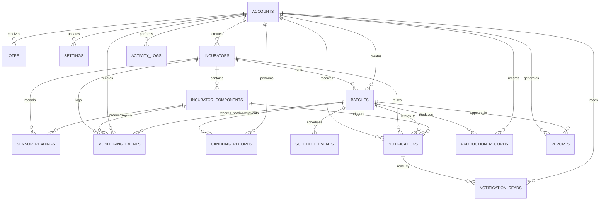

# SmartDuck Database ERD

The backend database `.smartduck-database.json` is consolidated to match the current admin/user website. Related data that can live in a parent record has been merged to avoid unnecessary tables.

ESP32 temperature and humidity readings are included in `sensor_readings`.
New hardware-enabled batches store `automationEnabled`; ESP32 candling and
egg-turning transitions are stored idempotently in `monitoring_events`, mirrored
to `activity_logs` for History, and create notification/alert-report records when
the event is user-facing.

## Tables

1. `accounts`
2. `otps`
3. `settings`
4. `incubators`
5. `incubator_components`
6. `sensor_readings`
7. `monitoring_events`
8. `batches`
9. `candling_records`
10. `schedule_events`
11. `notifications`
12. `notification_reads`
13. `production_records`
14. `reports`
15. `activity_logs`

## Main Relationships

